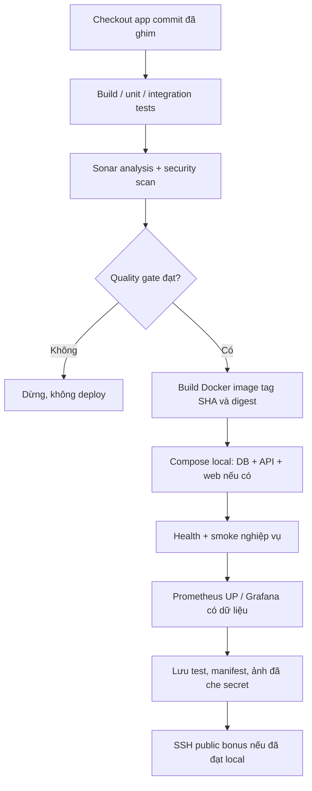

# Pipeline đề xuất (CHƯA TRIỂN KHAI)

## Ownership
- Dockerfiles build ứng dụng sẽ ở repo app cạnh backend/web sau khi thực hiện.
- Repo này giữ Compose, Jenkinsfiles, monitoring configs và scripts/runbook.
- Jenkins checkout app tại APP_COMMIT vào workspace/app, dùng Dockerfile/context đúng version. Bộ kiểm tra chất lượng/an toàn chạy theo source app đã ghim, không tham chiếu repo môn khác.
- Mốc MVP 02/11 đã có web JavaScript chạy từ source và Android dùng chung API. Chưa có web/build output; pipeline phải dùng đúng cấu trúc source và ghim commit, không giả định là dự án SPA có bước build sẵn.

## Mô hình chạy dự kiến
Web/mobile → reverse proxy/API → PostgreSQL + file volume. Prometheus scrape API trong network nội bộ; Grafana đọc Prometheus. Jenkins và Sonar trên máy cá nhân/node phù hợp, metrics/admin UI không tự mở public.

## Việc cần kiểm chứng
JDK 21/Node theo app; Testcontainers dùng PostgreSQL thật; Sonar webhook/timeout; secret chỉ trong Jenkins credential; image không chứa secrets/compiler; volume không xóa để chữa lỗi; restore sang DB thử riêng; rollback image tương thích schema. Các mục này chưa chạy.

Nguồn app: https://github.com/Khiemnh158/worksphere-app; framework pipeline cần theo phiên bản tool thực tế được cài. Jenkins bắt buộc trong mẫu, GitHub Actions chỉ là bổ sung nếu làm sau.
