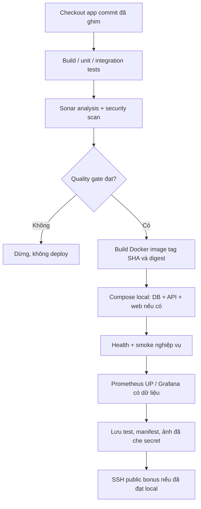

# Kế hoạch bắt đầu môn Triển khai phần mềm

Bản kế hoạch lập ngày 05/11/2026. Dùng [runbook](../runbooks/LOCAL.md) cho lệnh hiện hành, [TODO](../TODO.md) cho việc còn lại và [STATUS](../STATUS.md) cho kết quả thực tế. Các khảo sát và pin trong kế hoạch ghi lại đầu vào ban đầu.

## Phạm vi và đầu vào

Đóng gói và triển khai WorkSphere đã có, không xây lại UI/nghiệp vụ/mobile. Jenkins local, Docker/Compose, Sonar tích hợp Jenkins, Prometheus/Grafana local và quyển ảnh thật là các phần cần ưu tiên theo mẫu. SSH deploy server public là bonus sau local. Backup/restore/rollback là bổ sung vận hành của dự án, không tự coi là tiêu chí điểm bắt buộc.

- Nguồn chuẩn là repo app, pin `8f342548fbdab566e4e930ae2df6365480fd1c90`, tag `coursework-mvp-2026-11-02`. Giữ **JDK 21**, Node 24; không tự nâng runtime/framework.
- Mốc nghiệm thu 02/11 có 407 backend, 852 mobile, 8 web tests. Lần kiểm tra 05/11: 51 unit, 8 web, 852 mobile đạt; nhóm PostgreSQL 58/59. Chưa chạy lại đủ 407 vì Docker engine chưa sẵn sàng. Không ghép kết quả các lần thành một lượt PASS.
- Test QR `qrStationRequiresSpecialistAndRejectsExpiredReplayAndClosedStation` trộn service clock cố định 10:00 với thời hạn QR lấy `now()` từ DB. Sửa fixture dùng cùng mốc ngày/giờ/thời hạn, cả INSERT và UPDATE; không nới luật hết hạn của nghiệp vụ.
- Docker CLI có nhưng Linux engine chưa chạy khi khảo sát. Kiểm tra lại RAM/cổng trước khi bật stack; lưu công việc và giảm tải IDE/giả lập nếu cần, không tự đóng ứng dụng có dữ liệu chưa lưu.
- Hai thay đổi Android local có từ trước lần nâng Java nhầm (Foojay resolver, daemon toolchain 21) không thuộc snapshot GitHub. Giữ riêng, không đưa vào repo triển khai.
- Mọi sửa app cho fixture/container/metrics phải ở nhánh riêng, có kiểm thử và commit mới rồi mới đổi pin triển khai. Không di chuyển tag MVP hoặc copy backend.

## Pipeline mục tiêu

## Ownership
- Dockerfiles build ứng dụng sẽ ở repo app cạnh backend/web sau khi thực hiện.
- Repo này giữ Compose, Jenkinsfiles, monitoring configs và scripts/runbook.
- Jenkins checkout app tại APP_COMMIT vào workspace/app, dùng Dockerfile/context đúng version. Bộ kiểm tra chất lượng/an toàn chạy theo source app đã ghim, không tham chiếu repo môn khác.
- Mốc MVP 02/11 đã có web JavaScript chạy từ source và Android dùng chung API. Chưa có web/build output; pipeline phải dùng đúng cấu trúc source và ghim commit, không giả định là dự án SPA có bước build sẵn.

## Mô hình chạy dự kiến
Web/mobile → reverse proxy/API → PostgreSQL + file volume. Prometheus scrape API trong network nội bộ; Grafana đọc Prometheus. Jenkins và Sonar trên máy cá nhân/node phù hợp, metrics/admin UI không tự mở public.

## Việc cần kiểm chứng
JDK 21/Node theo app; Testcontainers dùng PostgreSQL thật; Sonar webhook/timeout; secret chỉ trong Jenkins credential; image không chứa secrets/compiler; volume không xóa để chữa lỗi; restore sang DB thử riêng; rollback image tương thích schema. Các mục này chưa chạy.

Nguồn app: https://github.com/Khiemnh158/worksphere-app; framework pipeline cần theo phiên bản tool thực tế được cài. Jenkins bắt buộc trong mẫu, GitHub Actions chỉ là bổ sung nếu làm sau.

## Mô hình local để thực hiện

- Jenkins controller Docker và agent Linux riêng có JDK 21/Node 24/Maven/Docker CLI; controller không chạy build. Chỉ agent tin cậy dùng Docker daemon, không chạy mã PR bất kỳ; tắt build đồng thời để tránh giẫm DB/stack.
- Kiểm chứng Testcontainers trong agent trên Docker Desktop, bao gồm `TESTCONTAINERS_HOST_OVERRIDE=host.docker.internal`. Có CLI chưa chứng minh engine chạy. Xem [Jenkins Docker](https://www.jenkins.io/doc/book/installing/docker/) và [Testcontainers trong container](https://java.testcontainers.org/supported_docker_environment/continuous_integration/dind_patterns/).
- Jenkins/Sonar chung mạng CI để webhook truy cập được. Ghim phiên bản image/plugin và lưu manifest thực tế, không dùng `latest` làm bằng chứng tái lập.
- Web JavaScript tĩnh dùng Nginx phục vụ source, proxy `/api` tới backend. Backend multi-stage JDK 21 → JRE 21. Không đặt ra bước build SPA không có trong app.
- DB/uploads dùng named volumes riêng, không dùng DB thực hành. Không bind đường dẫn workspace trong agent thành đường dẫn host Windows; cấu hình tĩnh dùng build context/COPY hoặc Compose configs đã kiểm chứng.
- Chạy các bước nặng tuần tự; kiểm tra tài nguyên và yêu cầu Elasticsearch của [SonarQube](https://docs.sonarsource.com/sonarqube-community-build/server-installation/server-host-requirements) trước khi chọn bản cài.

| Dịch vụ | Cổng host dự kiến | Ghi chú |
| --- | --- | --- |
| Jenkins | 18081 | Local |
| SonarQube | 19000 | Local |
| Prometheus | 19090 | Local |
| Grafana | 13000 | Local |
| Web triển khai | 18210 | Tách web thực hành 18110 |
| API triển khai | 18220 nếu cần | Tách API thực hành 18120 |
| PostgreSQL/management metrics | Không publish | Mạng container nội bộ |

Cổng trống khi khảo sát không đảm bảo vẫn trống lúc chạy; kiểm tra lại trước khi khởi động.

## P0 — Điều kiện build tin cậy

1. Bật/kiểm tra Docker Linux engine, tài nguyên, quyền truy cập, cổng và phiên bản công cụ.
2. Sửa riêng fixture đồng hồ QR trong app; chạy lại nhóm PostgreSQL, giữ các ca hợp lệ/hết hạn/phát lại/điểm đóng.
3. Chạy bộ backend đầy đủ với Docker/Testcontainers và 59 ca PostgreSQL được bật theo cấu hình hiện có. Đọc report thực tế, không cộng trùng test. Kiểm tra web/mobile/TypeScript phù hợp với phạm vi thay đổi và ghi kết quả mới.
4. Commit app đã kiểm chứng, cập nhật pin nếu cần, giữ tag MVP. Không mang thay đổi Android không liên quan.

**Qua chặng khi:** JDK 21 build đạt, fixture ổn định, test bắt buộc chạy thật. Nếu chưa đạt thì sửa/ghi lỗi trước khi đi tiếp.

## P1 — Compose độc lập

1. Thêm Dockerfile/.dockerignore backend/web trong repo app, loại secrets/DB/node_modules/build cũ khỏi context/image.
2. Thêm Compose ở repo này: DB/API/web, network/volumes riêng, mẫu biến không chứa secret thật, healthcheck và phụ thuộc healthy. Xem [Compose startup order](https://docs.docker.com/compose/how-tos/startup-order/).
3. Bootstrap opt-in cho **DB triển khai rỗng riêng**, có kiểm thử. `WebDemoProvisioner` hiện chỉ chấp nhận JDBC loopback của DB thực hành nên hostname `postgres` không qua guard. Không bỏ guard cũ, không copy DB cá nhân; nhận secret từ ngoài image.
4. Smoke login/logout, chặn sai quyền, yêu cầu → phân công → nhận → hoàn tất → xác nhận, tệp đính kèm và restart giữ dữ liệu. Chỉ dùng dữ liệu thử.

**Qua chặng khi:** checkout sạch chạy stack theo hướng dẫn, không ảnh hưởng app thực hành; ghi image ID/tag/commit thật. Chỉ ghi repository digest khi có digest thật.

## P2 — Jenkins local

1. Dựng controller/agent, volume, tools/plugins và credentials; giới hạn truy cập.
2. Checkout app đúng pin vào workspace riêng, Maven wrapper Linux có quyền thực thi, JDK/Node đúng bản.
3. Jenkinsfile chạy checkout → cấu hình → build/test → lưu report kể cả fail → quality stage → image → Compose → health/smoke → manifest. DB thử riêng theo build, cleanup có giới hạn.
4. Lưu một build đạt và một build cố ý fail test trên nhánh thử để chứng minh fail chặn deploy. Không sửa source chuẩn bằng lỗi cố ý.

**Qua chặng khi:** có build ID/commit/report/smoke thực trong Jenkins, không thay bằng build thủ công.

## P3 — SonarQube và quality gate

1. Sonar + DB riêng; Jenkins plugin/token credential, webhook nội bộ có secret.
2. Chốt phạm vi Java/JS và chính sách gate trước nghiệm thu; bổ sung coverage thật nếu gate dùng. Không bỏ code nghiệp vụ hoặc hạ ngưỡng để ép xanh.
3. `withSonarQubeEnv` lưu analysis task ID; `waitForQualityGate` có timeout và abort khi không đạt. Kiểm tra cả lượt đạt và gate fail chặn deploy. Xem [Sonar/Jenkins gate](https://docs.sonarsource.com/sonarqube-community-build/analyzing-source-code/ci-integration/jenkins-integration/pipeline-pause).
4. Ghim scanner tương thích; runtime scanner tách khỏi compiler app, không nâng app Java 25 để chạy scanner. Xem [scanner requirements](https://docs.sonarsource.com/sonarqube-community-build/analyzing-source-code/scanners/scanner-environment/general-requirements) và [JRE provisioning](https://docs.sonarsource.com/sonarqube-community-build/analyzing-source-code/scanners/scanner-environment/managing-jre-auto-provisioning).

**Qua chặng khi:** Jenkins nhận gate thật; Sonar UI xanh riêng không thay minh chứng pipeline.

## P4 — Monitoring

1. App có Actuator nhưng chưa có Prometheus registry. Thêm dependency/cấu hình tối thiểu và test endpoint, ghim commit mới đã kiểm chứng. Dùng tài liệu Spring Boot đúng bản app khi thực hiện.
2. Management endpoint cần thiết chỉ trên mạng nội bộ, không public metrics/dữ liệu người dùng. Prometheus scrape và Grafana provisioning/dashboard lưu trong Git.
3. Sinh request thử, hiển thị request/lỗi/độ trễ/JVM. Dừng/bật API triển khai để thấy DOWN → UP, không tác động app thực hành. Xem [Spring Boot monitoring](https://docs.spring.io/spring-boot/reference/actuator/monitoring.html).

**Qua chặng khi:** target UP và dashboard có dữ liệu thực đúng khoảng thời gian thử.

## P5 — Nghiệm thu, vận hành, báo cáo

1. Checkout sạch chạy đầy đủ pipeline theo pin, lưu versions/build ID/commit/image/kết quả từng bước.
2. Backup/restore vào DB riêng, kiểm tra dữ liệu thử và tệp; rollback image có schema tương thích, nêu giới hạn migration. Không xóa volume để chữa lỗi.
3. Runbook yêu cầu máy, secrets, chạy/dừng, health, lỗi thường gặp, restore/rollback. Phân biệt thử clone cùng máy với nghiệm thu trên máy khác.
4. Thu ảnh tự làm theo ma trận môn, che secrets/thông tin cá nhân, gộp một quyển. Báo cáo Word/PDF theo mẫu, sơ đồ kiến trúc/CI/CD, kết quả/giới hạn và slide dựa trên kết quả thật.
5. Phân công/tự đánh giá theo việc có bằng chứng, không tự điền điểm/đóng góp. Diễn tập build, login, smoke, gate, dashboard và giải thích một ca fail.

**Qua chặng khi:** đóng checklist bắt buộc bằng minh chứng, tài liệu khớp bản clone. Phần chưa đạt ghi rõ, không tự đặt phần trăm.

## P6 — SSH public (bonus)

Chỉ sau local và khi có server được phép dùng: SSH credential, deploy đúng image, health/rollback, URL hoạt động và HTTPS phù hợp. Không tự mua server hoặc bịa địa chỉ/credential. Monitoring có thể giữ local theo mẫu.

## File sẽ thêm khi triển khai

| Nơi giữ | Nội dung |
| --- | --- |
| Repo app | Fixture QR, Dockerfile/.dockerignore, metrics/coverage nếu cần và test |
| `compose/` | Local/CI, mẫu biến, health/network/volumes; public nếu làm bonus |
| `jenkins/` | Jenkinsfile, controller/agent và hướng dẫn plugin/credentials |
| `monitoring/` | Prometheus scrape, Grafana provisioning/dashboard |
| `scripts/` | Preflight, checkout pin, smoke, backup/restore có giới hạn |
| `runbooks/` | Vận hành/sự cố/restore/rollback và bàn giao |
| `evidence/` | Chỉ mục ảnh đã che secret, build/commit/time thực |
| `versions.env`, `target.json` | Pin đã kiểm chứng và image/digest thật sau build |

Không commit `.env` thật, token/password, DB dump, dữ liệu nhân sự hoặc build cache. Chưa tạo file thực thi rỗng giả làm hạ tầng hoàn thành.

## Khi hồi hạn mức

Thứ tự **P0 → P1 → P2/P3 → P4 → P5**, P6 nếu có điều kiện. Ưu tiên lượt đầu: Docker engine, fixture/test và Compose độc lập. Mỗi lần dừng cập nhật TODO/STATUS: commit, bước cuối đạt, lỗi còn và bước tiếp theo. Hạn nộp chưa xác nhận; không hứa tất cả hoàn thành trong một lượt.

Phân việc đề xuất bốn người: app image/bootstrap; Jenkins/Sonar; monitoring/runbook; kiểm thử/minh chứng/báo cáo. Đây không phải xác nhận đóng góp thực tế. Chỉ làm song song sau khi thống nhất pin/cấu hình chung.

Câu tiếp tục: **“Bắt đầu P0 theo docs/PIPELINE_PLAN.md, giữ JDK 21 và dùng đúng pin; báo kết quả thật trước khi qua chặng tiếp theo.”**
